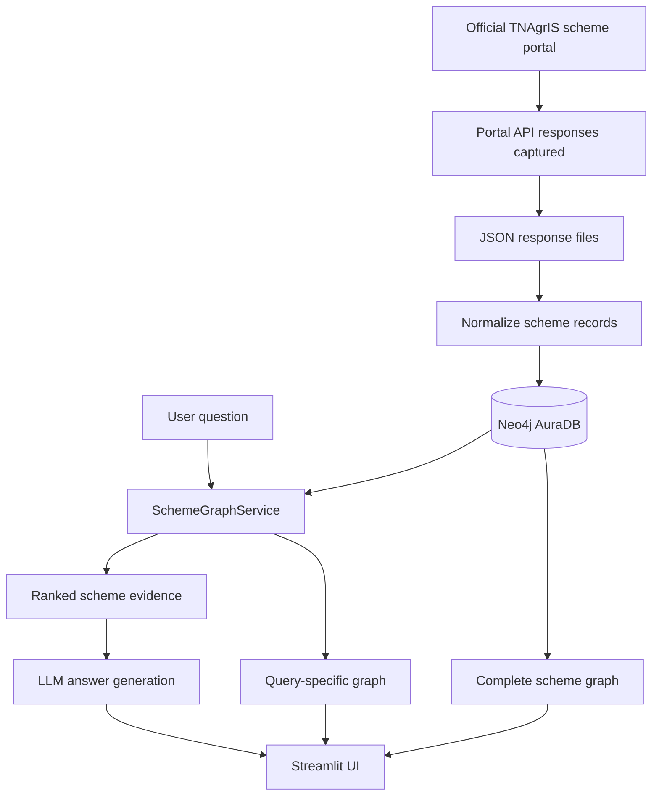
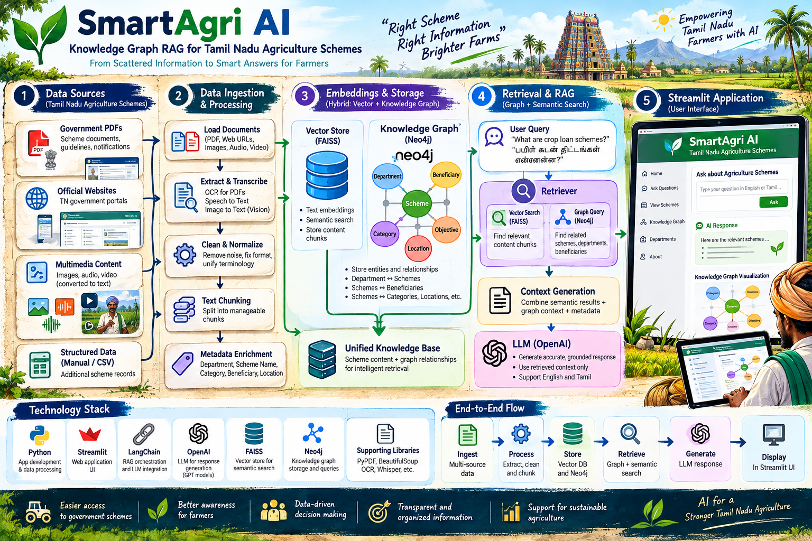
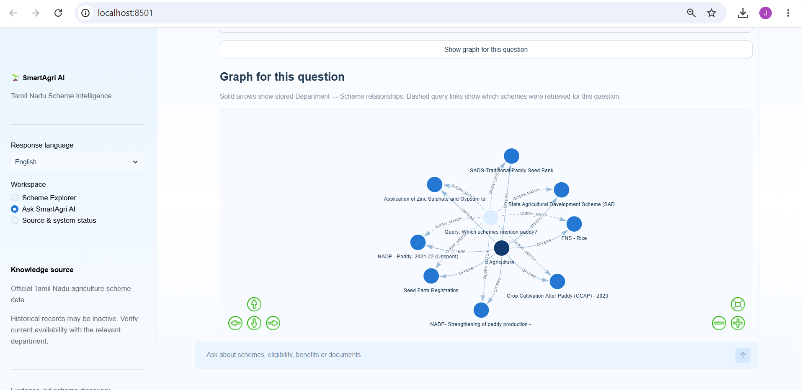
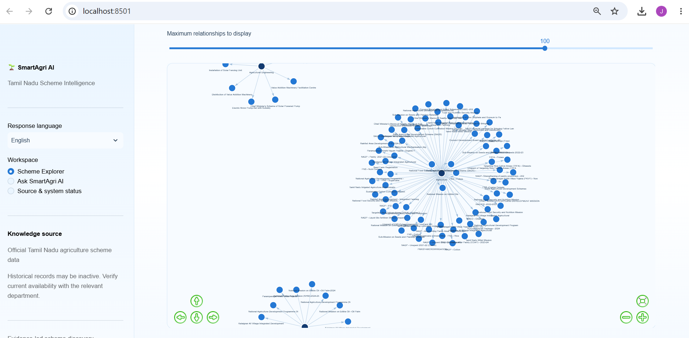

# SmartAgri AI — Tamil Nadu Scheme Intelligence

**A bilingual, source-aware scheme discovery assistant using Neo4j, Python, an LLM, and Streamlit.**

SmartAgri AI helps users explore scheme records captured from the Tamil Nadu Agriculture Information and Management System (TNAgrIS) portal. Users can browse scheme records, ask questions in English or Tamil, inspect retrieved evidence, and visualize the stored scheme graph or a query-focused graph.

> **Important:** This is an independent prototype, not an official government service. Records in the captured data include inactive and historical schemes. Always verify current availability, eligibility, benefits, deadlines, and required documents with the relevant official department.

## Current capabilities

- Streamlit interface with a light-blue visual theme.
- Scheme Explorer and Ask SmartAgri AI workflows.
- English/Tamil answer-language selection.
- Neo4j AuraDB graph containing Department and Scheme nodes.
- Keyword-weighted scheme retrieval using scheme names, descriptions, eligibility, documents, and department metadata.
- LLM answer generation based on retrieved evidence, with instructions not to invent missing facts.
- Scheme evidence cards and source URL display.
- Complete graph visualization and query-specific graph visualization.

## Architecture



## Technology stack

- Python 3.12
- Streamlit
- Neo4j AuraDB and the Neo4j Python driver
- OpenAI API for answer generation
- Playwright for inspecting the official portal
- JSON for captured and normalized data
- pytest / Python test scripts, where configured in the repository

## Current data snapshot

The captured API responses contain **123 scheme records across 8 department categories**:

| Department category | Records |
|---|---:|
| Agriculture | 75 |
| Horticulture | 23 |
| Agricultural Engineering | 9 |
| Seed Certification & Organic Certification | 1 |
| Marketing & Agri Business | 10 |
| Sugarcane | 2 |
| Tamil Nadu Watershed Development Agency | 1 |
| Tamil Nadu Agricultural University | 2 |
| **Total** | **123** |

The current Neo4j load contains 8 Department nodes, 123 Scheme nodes, and 123 `OFFERS` relationships. These counts describe the captured project snapshot, not the total number of currently available government schemes.

## Knowledge graph visualizations


## 🏗️ System Architecture

SmartAgri AI combines Knowledge Graph technology, retrieval-augmented generation (RAG), and an interactive Streamlit interface to help users explore Tamil Nadu agriculture schemes.



*End-to-end architecture: Data Sources → Ingestion & Processing → Vector Store and Knowledge Graph → Retrieval & RAG → Streamlit Application.*


### Query-specific graph

The query-focused visualization connects the current question to the schemes retrieved for that question. The question-to-scheme links are visualization links indicating retrieval, not persisted government-domain relationships.



### Complete scheme graph

The complete graph visualizes stored Department-to-Scheme relationships.



## Repository documentation

- [Architecture and runtime flow](docs/ARCHITECTURE.md)
- [Data sources and ingestion](docs/DATA_SOURCES.md)
- [Knowledge graph ontology](docs/ONTOLOGY.md)
- [Evaluation and guardrails](docs/EVALUATION.md)
- [Implementation plan and status](docs/IMPLEMENTATION_PLAN.md)

## Setup and run

Run commands from the repository root in the activated project virtual environment.

1. Install dependencies:

   ```powershell
   python -m pip install -r requirements.txt
   ```

2. Configure environment variables in `.env` using the variable names expected by the project. Do not share or commit credentials.

3. Verify Neo4j connectivity using the project connection-check script if present:

   ```powershell
   python scripts/test_neo4j_connection.py
   ```

4. Start the app:

   ```powershell
   streamlit run app.py
   ```

5. Run tests, if dependencies and test configuration are installed:

   ```powershell
   python -m pytest
   ```

If a script name differs in your checked-out version, use the actual script listed in `scripts/`. Do not run ingestion again unless you intend to refresh or replace the stored data.

## Data and retrieval notes

- The current retrieval method is **weighted keyword matching**, not vector similarity search or a full-text-index retrieval pipeline.
- Retrieval ranking scores are relevance-ranking signals, not calibrated confidence probabilities.
- Some records have `active=no`; `active=yes` should not be interpreted as proof that a scheme is currently open for applications.
- Several source URLs currently point to a department API endpoint rather than a unique detail page for each scheme. Source links should be improved and individually verified.
- The graph currently models Department and Scheme nodes. Eligibility and document details are stored as scheme properties rather than separate `Eligibility` or `Document` nodes.
- The captured response files are a data snapshot and may become stale.

## Responsible use

SmartAgri AI is for discovery and learning. It does not determine eligibility or guarantee that a scheme is active. Users should confirm scheme status and all application details through current official channels.
