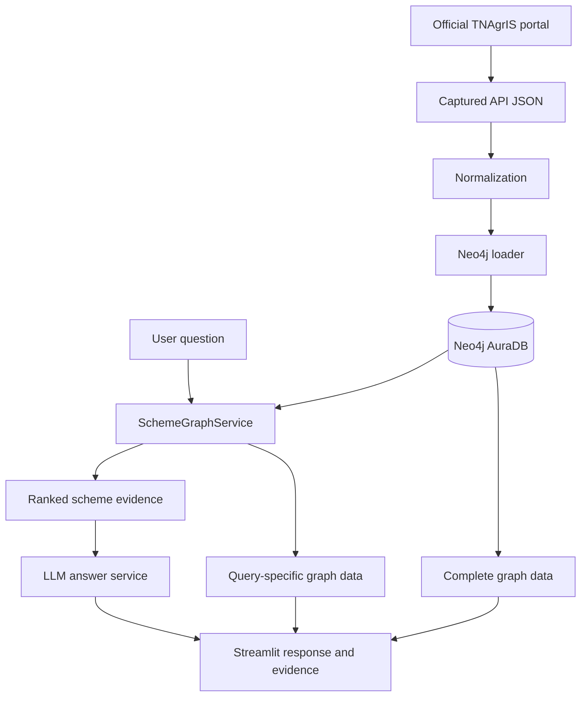

# Architecture

## Purpose

SmartAgri AI is a prototype for discovering Tamil Nadu government agriculture-related scheme records. The graph supports department-to-scheme exploration; a retrieval service ranks scheme records for a question; an LLM turns retrieved evidence into a readable response; and Streamlit presents answers, evidence, and graph visualizations.

## Implemented runtime flow

1. Captured responses from the official TNAgrIS portal API are stored in `data/processed/scheme_api_responses.json`.
2. Normalization produces `data/processed/schemes_normalized.json`.
3. The loader writes Department and Scheme nodes and `OFFERS` relationships to Neo4j AuraDB.
4. `SchemeGraphService` provides graph overview, complete graph data, query-specific graph data, and weighted keyword retrieval.
5. The retrieval service ranks candidate schemes using fields such as name, description, eligibility, required documents, and department.
6. `llm_service.py` sends retrieved evidence to the LLM with instructions to stay within the evidence and avoid inventing missing facts.
7. `app.py` presents the Scheme Explorer, Ask SmartAgri AI, evidence cards, source URLs, and graph views.

## High-level diagram

## Current graph model

The stored model currently contains:

- `(:Department)`
- `(:Scheme)`
- `(:Department)-[:OFFERS]->(:Scheme)`

Scheme properties include scheme identifiers and names, department metadata, year, active/deletion flags, descriptions, eligibility text, required-document text, and source URL metadata. Exact property names are defined by the loader and normalized records.

The graph is intentionally simpler than the proposed expanded ontology. Beneficiary, Benefit, Eligibility, Document, and Source nodes are not currently established as separate connected node types in the loaded graph.

## Retrieval and answer generation

Retrieval currently uses weighted keyword matching against scheme metadata. It is not a vector-search implementation and should not be described as semantic similarity search. The score orders candidates; it is not a probability that an answer is correct.

Retrieved records are passed to the LLM as evidence. The LLM is instructed not to fabricate unsupported facts. This instruction reduces risk but does not guarantee that every generated sentence is correct; evidence should remain visible so users can verify details.

## Query-specific graph semantics

The query-focused visualization contains a synthetic question/root node connected to retrieved Scheme nodes, alongside stored Department-to-Scheme relationships returned from Neo4j. The question-to-scheme edges mean “retrieved for this question”; they are visualization-only and should not be represented as persisted factual relationships.

## Trust boundaries and safety

- Treat external source text as untrusted input.
- Treat user questions as data; do not interpolate them into executable Cypher.
- Keep Neo4j credentials and API keys in `.env` or a secret manager. Never commit `.env`.
- Use read-only database credentials for deployed read paths where feasible.
- Do not infer eligibility, subsidy amounts, deadlines, or document requirements from a scheme title alone.
- Clearly distinguish source-backed details from missing evidence.

## Deployment boundary

Current target: local Streamlit application connected to Neo4j AuraDB and an LLM API.

Potential next steps include stronger schema validation, reviewed source provenance, more precise scheme-level source links, retrieval evaluation, multilingual test coverage, and deployment hardening.
